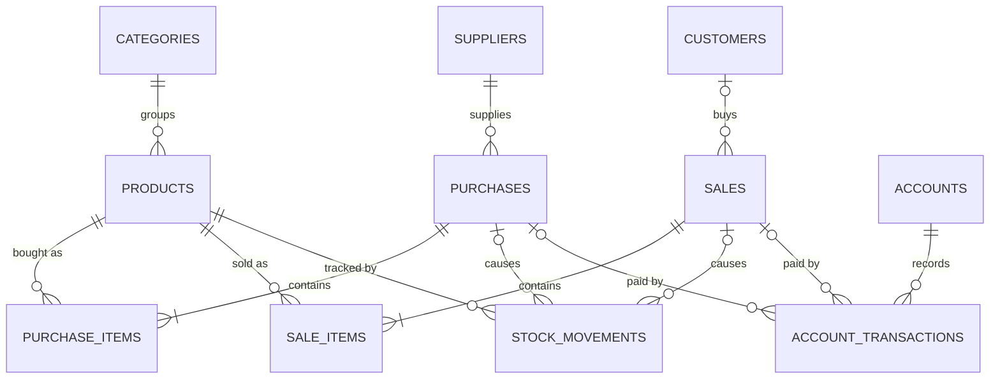

# Design Document: Inventory, Sales and Money Management API

Status: v1 design (single-tenant), agreed before implementation. Update this file when a decision changes.

## 1. Overview

A backend API (Laravel 13, Sanctum tokens) for a small trading shop. It tracks products and stock, purchases from suppliers, sales to customers, and the money moving through the shop's accounts, including credit in both directions.

It is a lightweight ERP for a trading business: inventory, purchasing, sales, and accounts payable and receivable.

## 2. Deployment model and launch plan

- **One deployment per shop.** Each shop gets its own copy of the app and its own database. There is no tenant concept in the code.
- **Hosted on a small cloud server** run by the developer (the family shop first), not on a shop PC. The shop only needs a browser or phone and an internet connection.
- Online-only. Connectivity and power are reliable for the target shops, so no offline sync in v1.
- The API comes first. A web or mobile client is built on top of it later. A mobile-only app without a backend is deliberately not pursued: a single phone holds a single copy of the data, so a second device or user would need syncing, and a lost phone would lose the records.
- Multi-tenancy is revisited only when real shops are waiting for it. To keep that change manageable, keep the code clean: Form Requests for validation, Eloquent models for data access, no scattered raw queries, no hard-coded assumptions about a single shop beyond the deployment itself.

## 3. Scope of v1

In scope:

- Master data: categories, suppliers, customers, products, accounts.
- Stock ledger with adjustments.
- Purchases and sales with items, document numbers, and stock rules.
- Partial payments on purchases and sales (credit in both directions).
- Expenses, transfers between accounts, owner deposits and withdrawals, and reconciliation adjustments.
- Voiding of documents and payments.
- Reports: stock, amounts owed to suppliers, amounts owed by customers, account balances, cash flow, simple profit.

Out of scope for v1 (possible later): multi-tenancy, payroll or employee records, expense categories, customer returns and refunds workflow, due dates and credit limits, interest, costing methods such as weighted average, offline mode, custom roles, subscription billing, mobile-only app.

## 4. Key decisions

1. **Ledgers, not edited numbers.** Stock and money are append-only ledgers. Stock, balances, paid amounts, and statuses are always calculated, never stored.
2. **Corrections by reversal.** Nothing financial is edited or deleted. A mistake is voided with a required reason, which adds reversing entries, and the correct entry is recorded afterwards. Only non-financial fields (notes, invoice number) may be edited directly.
3. **Whole-item quantities.** Quantities are integers. Money is decimal(12,2) and totals are computed in whole cents to avoid floating-point errors.
4. **Prices are snapshots.** Unit cost and unit price are copied onto document items, so history never changes when prices change.
5. **Single-tenant, one deployment per shop.** Simpler to build, test, and reason about, and enough for the first real shop. Multi-tenancy is a later decision.
6. **Permissions, not roles, in code, using spatie/laravel-permission.** Code checks named permissions (for example `sales.void`). Roles and permissions live in the database, created by a seeder. v1 ships with fixed roles (owner, staff); a screen for custom roles can be added later without changing any permission check.
7. **Credit needs identity.** Credit sales are only allowed for registered customers. Walk-in sales must be paid in full when the sale is created.
8. **Partial payments are allowed.** A document can have many payments. Its status is derived from them.
9. **Account balances reflect reality.** The money ledger covers payments, expenses (including salaries, which are just expenses with a reason), transfers, owner entries, and reconciliation adjustments.
10. **Negative balances are flagged, not blocked.** Shops forget to record entries, and blocking would frustrate them. A negative balance is shown as a warning in reports.
11. **Fail-safe operations.** Every multi-row write runs in a database transaction. Operations that depend on current stock or balances lock the rows involved.

## 5. Conventions

- API prefix `/api/v1`. JSON only (clients send `Accept: application/json`).
- Validation in Form Requests. Output through API Resources. Controllers stay thin.
- Every record that a user creates stores `created_by`.
- Master data uses soft deletes. Documents and ledger rows are never deleted.
- Status codes: 401 not logged in, 403 not allowed, 404 not found, 409 conflict with current state, 422 validation or business-rule failure.
- Database: MySQL/MariaDB in production (decided in phase 1). SQLite is used for local development and the regular test suite. Row locking is required; SQLite ignores it, so concurrency tests must run against MySQL.

## 6. Data model

Timestamps are on every table.

### Users
- `users`: name, email (unique), password. There is no role column: roles come from spatie/laravel-permission.
- Spatie tables (`roles`, `permissions`, `model_has_roles`, `model_has_permissions`, `role_has_permissions`) are created by the package's migration.

### Master data
Every master data table also has `created_by` (nullable, the user who created the row).

- `categories`: name (unique), description.
- `suppliers`: name, contact_person, phone, email, address, deleted_at.
- `customers`: name, phone (unique when present), address, deleted_at.
- `products`: category_id, sku (unique), name, description, unit (text label such as "bag"), cost_price, selling_price, reorder_level (integer), deleted_at.
- `accounts`: name (unique), type (cash, bank, mobile_money), opening_balance, is_active. Accounts are never deleted, only deactivated. `opening_balance` may be negative (an account that starts overdrawn) and is fixed once the account is created; a wrong opening balance is corrected with an `adjustment` transaction.

### Documents
- `purchases`: number (unique, for example PUR-000123), supplier_id, invoice_number, purchase_date, total_amount, note, status (active, voided), voided_at, voided_by, void_reason, created_by.
- `purchase_items`: purchase_id, product_id, quantity, unit_cost, previous_cost_price (the product's cost just before this purchase changed it, used to restore it when the purchase is voided).
- `sales`: number (SAL-000123), customer_id (nullable), sale_date, total_amount, note, status, voided_at, voided_by, void_reason, created_by.
- `sale_items`: sale_id, product_id, quantity, unit_price, unit_cost (snapshot of the product's cost at the time of sale).
- `document_sequences`: type (unique), last_number. One row per document type (purchase, sale). To number a new document, lock its row inside the same transaction, add 1 to `last_number`, and format the result (for example SAL-000204). A rollback also rolls back the counter, so numbers have no gaps.

### Ledgers (append-only)
- `stock_movements`: product_id, type (purchase, sale, adjustment, reversal), quantity (signed: positive in, negative out), reference (polymorphic, nullable: purchase or sale), note, created_by.
- `account_transactions`: account_id, type (sale_payment, purchase_payment, expense, transfer_in, transfer_out, owner_deposit, owner_withdrawal, adjustment, reversal), amount (signed: positive money in, negative money out), transaction_date, note, receipt_reference, reference (polymorphic, nullable: purchase or sale), transfer_group (uuid, nullable), reverses_transaction_id (nullable, unique: an entry is reversed at most once), created_by.
  - `note` is required for expense, adjustment, and reversal (the reason).

Register short morph aliases (`purchase`, `sale`) with `Relation::morphMap()`, not `enforceMorphMap()`, which breaks Sanctum's token ownership lookup unless `User` is mapped too.

### Entity relationships

## 7. Derived values (never stored)

- Product stock = sum of `stock_movements.quantity` for the product.
- Account balance = `opening_balance` + sum of `account_transactions.amount` for the account.
- Sale paid amount = sum of `amount` on its payment and reversal rows. Purchase paid amount = minus the sum (purchase payments are money out).
- Balance due = document total - paid amount.
- Payment status: unpaid (paid is zero), partial (between zero and total), paid (equals total).
- Supplier payable = sum of balance due on the supplier's active purchases.
- Customer receivable = sum of balance due on the customer's active sales.
- Simple profit = sum over sale items of (unit_price - unit_cost) x quantity, minus net expenses, for active documents in a period.
- Inventory value = sum over products of stock x `cost_price` (at cost; the value at selling price is shown for information only).
- Net worth = sum of account balances + inventory value + customer receivables - supplier payables.

If reports ever become slow, cached columns may be added, but only alongside the verify command (section 12) that checks them against the ledgers.

## 8. Business rules

1. Stock never goes negative. Sales, negative adjustments, and voids that remove stock check current stock while holding a lock on the product rows, locked in a consistent order (by id) to avoid deadlocks. Lock order in every transaction: product rows (by id), then document rows, then the `document_sequences` row, then account rows (by id). Every money ledger write locks its account row. On MySQL (REPEATABLE READ) the first plain read in a transaction fixes its snapshot, so take the locks before any plain read whose result a later check depends on (read immutable rows, such as document items, before the transaction starts).
2. A sale that is not fully paid when created requires a customer. Walk-in sales must be paid in full.
3. A payment cannot exceed the balance due (422) and cannot be recorded against a voided document (409). Recording a payment locks the document row first. A payment against a purchase also needs `purchases.create`, so staff can only take payments for sales.
4. A document can be voided only if its net payments are zero (any payments must be voided first) and the reversal passes the stock rule.
5. Voiding requires a reason. The system records who voided it and when, and adds reversing stock movements. Voided documents remain visible, marked as voided, and are excluded from totals and reports. Voiding an already voided document returns 409; a document with non-zero net payments returns 422. Locks: the item products (by id), then the document. A product deleted since the document was posted blocks the void (422).
   - Voiding a purchase restores each product's `cost_price` to the item's `previous_cost_price`, but only when this purchase is still the latest active purchase of the product and the cost still equals the item's `unit_cost` (a later purchase or a manual edit is left alone).
6. A wrong ledger entry (payment, expense, owner entry, transfer, adjustment) is corrected by a reversal row that points to the original and has the opposite amount. Transfers are reversed as a pair: reversing either side writes two reversal rows sharing a new `transfer_group`.
   - A reversal keeps the original's document reference, so the document's paid amount and payment status follow automatically.
   - A reversal cannot itself be reversed (422); record the correct entry again instead. An entry already reversed returns 409.
   - The reversal is dated today by default. An earlier `transaction_date` may be sent, but never in the future and never before the original's date.
   - Reversing a sale or purchase payment needs `payments.void`. Reversing any other entry needs `accounts.manage`.
   - Locks: the referenced document (if any), then the account rows (by id); the "already reversed" check runs after the locks.
7. A transfer needs two different accounts and always creates its two rows together.
8. Item product ids within one document must be distinct. Quantities are at least 1.
9. Prices and costs are copied to the items at creation. A sale item's `unit_price` defaults to the product's selling price and may be overridden per item; its `unit_cost` is always the product's cost price at that moment. A purchase sets each product's `cost_price` to the item's `unit_cost` (last purchase cost).
10. Document numbers are sequential per document type, generated under a lock.
11. Dates on documents cannot be in the future.
12. Soft-deleted products cannot be used on new documents.
13. A category cannot be deleted while any product (including soft-deleted ones) belongs to it (409). Deleting a product is a soft delete, refused with 409 while the product still has stock on hand (adjust it to zero first).

## 9. Core flows

**Purchase with partial payment.** One request creates the purchase, its items, stock movements (+quantity per item), and optional payment rows, in one transaction. The server computes the total; the client never sends it.

**Credit sale.** Same shape as a purchase, with stock check and lock first. If the sum of initial payments is less than the total, a customer is required. The customer's receivable is derived.

**Later payment.** A new `sale_payment` or `purchase_payment` row against an existing document, within the balance due.

**Void a sale.** Requires a reason and no active payments. Marks the sale voided and adds positive reversal stock movements. The receivable disappears because the document is excluded.

**Wrong payment.** Add a reversal row pointing at the original; then record the correct payment.

**Expense.** A negative `expense` row on an account with a required reason. Salaries are expenses whose reason says so.

**Transfer.** Two rows in one transaction sharing a `transfer_group`: negative on the source, positive on the destination.

**Reconciliation.** Count the real cash or bank balance, then record the difference as an `adjustment` with a reason.

**Stock adjustment.** A signed `adjustment` stock movement with a required reason. Opening stock is a positive adjustment.

## 10. API outline

Prefix `/api/v1`. All routes except login need a Sanctum token. Permissions are checked by name.

- Auth: `POST /auth/login`, `POST /auth/logout`, `GET /auth/me`.
- Two ways to log in, accepted side by side by `auth:sanctum`:
  - **Tokens** (mobile app, Postman, scripts): `POST /auth/login` returns a bearer token; `POST /auth/logout` revokes it.
  - **Cookie session** (the web app): `GET /sanctum/csrf-cookie`, then `POST /auth/session` with email and password; later requests send the session cookie and the `X-XSRF-TOKEN` header. `DELETE /auth/session` logs out. The cookie cannot be read by scripts, so an XSS bug cannot steal the login. A CSRF failure returns 419.
  - Cookie sessions only work for origins listed in `SANCTUM_STATEFUL_DOMAINS` (derived from `FRONTEND_URL` when unset). CORS allows only `FRONTEND_URL`, with credentials. In production the web app and the API share a parent domain (for example `app.shop.com` and `api.shop.com`, with `SESSION_DOMAIN=.shop.com` and `SESSION_SECURE_COOKIE=true`).
- Users: list and create (`users.manage`). There is no public registration.
- Master data CRUD: categories, suppliers, customers, products, accounts.
- Stock: `GET /stock-movements` (filters: product, type), `POST /stock-adjustments`.
- Purchases: `GET /purchases`, `GET /purchases/{id}`, `POST /purchases`, `POST /purchases/preview`, `PATCH /purchases/{id}`, `POST /purchases/{id}/void`.
- Sales: `GET /sales`, `GET /sales/{id}`, `POST /sales`, `POST /sales/preview`, `PATCH /sales/{id}`, `POST /sales/{id}/void`.
- Preview: same body, validation and permissions as creating the document; nothing is saved. Field errors are a 422 as when saving. Business rules do not stop a preview: it returns 200 with the totals and `problems` (`rule`, `message` (the text saving would return), `field`), listing all of them (`overpaid`, `walk_in_not_paid`, `insufficient_stock` pointing at `items.N.quantity`); empty means it can be saved. Its stock check takes no lock, so saving checks again.
- Edit: only the note (sales) or the note and invoice number (purchases), also on voided documents; any other field is a 422.
- Document lists: `search` (number, customer or supplier name, purchase invoice number) and `payment_status=unpaid|partial|paid` (active documents only), besides party, status and dates.
- Viewing: purchases need `purchases.create`. Sales are visible to any logged-in user, but sale items show `unit_cost` only to users with `reports.view`.
- Money: `GET /account-transactions`, `POST /payments` (against a document), `POST /expenses`, `POST /transfers`, `POST /owner-entries`, `POST /account-adjustments`, `POST /account-transactions/{id}/reverse`.
- Reports: stock levels and low stock, supplier payables, customer receivables, account balances, cash flow, profit.
- `GET /reports/summary` (`reports.view`): account balances, inventory value, receivables, payables and net worth, as of now.
- `GET /reports/profit` and `GET /reports/cash-flow` (`reports.view`), for a period: `from` and `to` (both days included; default the current month) and optional `group_by=day|month` for a series with every period present (day grouping up to a year).
  - Profit: sales and cost of sales from the active sales' item snapshots, minus net expenses (expenses less their reversals, each on its own date).
  - Cash flow: opening balance, money in and out by type, closing balance, for all accounts or one (`account_id`). A reversal counts under the type it cancels. Across all accounts, transfers are left out (they only move money inside the shop); for one account they are included. Opening + in - out = closing.
  - The other planned reports are list filters: stock levels (`/products?stock=low|out&sort=stock`), payables and receivables (`/suppliers` and `/customers` with `?has_balance=1`), account balances (`/accounts`).
- Account balances are shown on accounts only to users with `accounts.manage` or `reports.view`.
- The ledger (`GET /account-transactions`) is readable with `reports.view` or `accounts.manage`, so whoever can reverse entries can find them. Its `search` matches the note, the receipt reference and the referenced document's number. `expenses.record` alone does not open it (reversing an expense needs `accounts.manage` anyway).
- `POST /account-adjustments/preview` (`accounts.manage`): the same body as a reconciliation, with the reason optional, saves nothing and returns the current balance, the counted balance and the signed difference (counted minus balance; `0.00` when it already matches).
- Lists are paginated, 10 rows per page by default; `per_page` takes 1 to 100.
- Customers show `receivable` (what they owe on active sales) to everyone, since staff take payments and already see each sale's balance due. Suppliers show `payable` (what the shop owes on active purchases) only to users with `purchases.create` or `reports.view`. `?has_balance=1` lists only those with something owed. Both are calculated in SQL with the list.
- Products: `?stock=low` (above zero, at or below the reorder level) or `?stock=out` (zero or less); `?sort=name|stock|-stock`.
- Ledger rows and documents name their documents and users for display: `reference_number` (for example SAL-000012) on stock movements and account transactions, `created_by_user` and `voided_by_user` as `{id, name}`.

## 11. Permissions (v1 proposal)

Named permissions: `products.manage`, `stock.adjust`, `purchases.create`, `purchases.void`, `sales.create`, `sales.void`, `payments.record`, `payments.void`, `expenses.record`, `accounts.manage`, `suppliers.manage`, `customers.manage`, `reports.view`, `users.manage`.

- **owner:** all permissions.
- **staff (for shops with more than one user):** view master data, `customers.manage` (to register credit customers), `sales.create`, `payments.record` for sales. No voiding, purchases, expenses, accounts, or reports.

Implementation with spatie/laravel-permission:
- A seeder creates the permissions and the two roles, so every environment gets the same set.
- Routes and code check permissions (`permission:` middleware, `$user->can('sales.void')`), never role names.
- `GET /auth/me` returns the user's permission names so a frontend can show or hide actions. The backend still enforces every rule.
- After changing permissions, run `php artisan permission:cache-reset`.
- The package's teams feature is not used (single-tenant).

Custom roles and user management (`users.manage`):
- `GET /permissions` lists the permissions with a label and a group for the role editor. `GET/POST/PATCH/DELETE /roles` manage roles as a name plus permission names. One role per user.
- The owner role always has every permission and cannot be edited or deleted (409). The seeder re-syncs it, so a new permission reaches the owner. Staff and custom roles are editable; the seeder creates staff only when it is missing and never overwrites edits.
- No escalation: a user can create, edit or assign only roles whose permissions they hold themselves (403). The owner holds all of them.
- A role in use cannot be deleted (409). No change may leave the shop without an active user holding `users.manage` (409); nobody can deactivate themselves.
- Users can be edited (name, email, role) and deactivated. Deactivating ends all of the user's tokens and sessions, and an inactive user is refused on login and on every request (their old token gets 401). Their history keeps their name.
- Passwords: an admin can set a new password for a user, which ends that user's logins; any user can change their own with the current password, which ends their other logins.
- Permission changes take effect on the next request (checks read permissions per request; the cache is flushed on every role change).

## 12. Operations and quality

- **Tests, written in every phase:** stock rules and concurrency, totals and cents arithmetic, payment status, voiding rules, permissions, validation. The regular suite runs on in-memory SQLite. Concurrency tests live in `tests/Concurrency` (Pest group `mysql`) and run against a throwaway MySQL from `docker-compose.yml`, with committed data and real parallel processes; they are skipped when that database is not running.
- **Verify command** (`php artisan inventory:verify`): recalculates everything from the ledgers and checks that document totals equal the sum of their items, active documents have matching movements and payments within limits, voided documents net to zero, transfer groups sum to zero, and no product has negative stock.
- **Hosting:** a small cloud server (PHP, MySQL or PostgreSQL, web server, HTTPS) with `APP_DEBUG=false`, a queue-free setup to start with, and a documented update procedure.
- **Backups:** automated database backups to a separate location, with a tested restore, from the first real use.
- **API documentation:** generated from the code (for example Scramble).
- **Seeders and factories** for realistic demo data. A clean `.env.example`. A README that links to this document.
- **CI:** a pipeline that runs the tests on every push.

## 13. Build plan

The repository starts from a fresh Laravel skeleton. Each phase is built on its own feature branch (for example `phase-1-foundation`) with small commits, and merged into `main` once its tests pass.

1. **Foundation:** database choice, users, spatie/laravel-permission with the permissions and roles seeder, Sanctum login, base response and error conventions, a command to create the owner, first feature tests.
2. **Master data:** categories, suppliers, customers, products, accounts.
3. **Stock ledger and adjustments.**
4. **Purchases and sales:** numbering, nested items, stock rules, and the payments sent with a new document (this phase creates `account_transactions` for `sale_payment` and `purchase_payment`).
5. **Money ledger:** later payments against documents, expenses, transfers, owner entries, reconciliation, account balances, and the business summary report.
6. **Voiding:** documents and ledger entries.
7. **Reports.**
8. **Professional finish:** API docs, README, verify command, backups, cloud deployment, CI.

Each phase ends with passing tests and a commit before the next begins.

## 14. Open questions and later work

- Multi-tenancy, when real shops are waiting for it.
- Business summary as of a past date: needs a business date on stock movements and historical cost prices.
- Costing method for profit (current: product cost at time of sale; later: weighted average).
- Expense categories (small upgrade: a nullable category on expenses).
- Returns and refunds workflow, due dates, credit limits.
- An endpoint to restore a soft-deleted product (until then, a deleted product blocks voiding documents that use it).
- Employees and payroll.
- A screen for custom roles (the permission system already supports it).
- Web or mobile client on top of the API.
- Subscription billing and self-service signup (only relevant with multi-tenancy).
